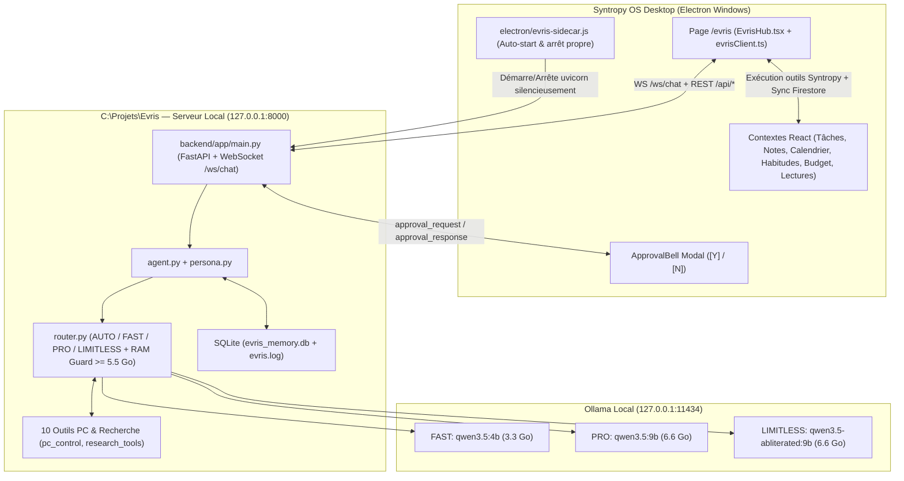

# PLAN_IA — Roadmap d'Intégration d'E.V.R.I.S. dans Syntropy OS

> **Objectif immédiat (Étape 1)** : Relier ton vrai **E.V.R.I.S. local** (`C:\Projets\Evris`) à l'application **Syntropy OS Desktop** sur ton PC.  
> **Version Site Web (`second-brain-os-e6a83.web.app`)** : Reportée volontairement en **Étape 5 (Plus tard)**.  
> **Modalité** : **100 % texte** (aucun module vocal) • **100 % local** via Ollama (`qwen3.5:4b`, `qwen3.5:9b`, `huihui_ai/qwen3.5-abliterated:9b`) sur ta workstation (`32 Go RAM + RTX 5060 8 Go VRAM`).

---

## 1. Vue d'Ensemble de la Roadmap

| Étape | Titre | Périmètre | Statut |
| :---: | :--- | :--- | :---: |
| **0** | **Interface `/evris` dans Syntropy OS** | Bouton sidebar `E.V.R.I.S.`, HUD 5 onglets, `ApprovalBell`, client REST/WS prêt | ✅ Fait (v2.7.8) |
| **1** | **Lien Direct E.V.R.I.S. ↔ App Desktop PC** | Serveur FastAPI/WS dans `Evris` + lancement auto silencieux via Electron | 🎯 **Prochaine étape** |
| **2** | **Autonomie sur les 6 Modules Syntropy OS** | Lecture + Création/Édition + confirmation `ApprovalBell` sur suppressions + Markdown riche | ⏳ À faire |
| **3** | **Intégration Transversale Desktop** | Palette `Ctrl+K`, actions IA dans `/notes`, Briefing du jour sur `/` | ⏳ À faire |
| **4** | **Multi-Conversations & Fiabilisation** | Historique multi-chats SQLite, reconnexion WS auto, suite `pytest` | ⏳ À faire |
| **5** | **Extension Version Site Web (Navigateur)** | Accès navigateur local, tunnel sécurisé (Tailscale/Cloudflare) et/ou fallback mini-LLM WebGPU / API | 🌐 **Plus tard** |

---

## 2. Architecture Cible (Desktop PC Local)

---

## 3. Détail des Étapes de la Roadmap

### ✅ Étape 0 — Interface `/evris` dans Syntropy OS *(Terminée en v2.7.8)*
- Bouton `E.V.R.I.S. [IA]` activé dans la barre latérale (`src/components/Sidebar.tsx`).
- Page `/evris` complète (`EvrisHub.tsx`, `evrisClient.ts`, `evris.ts`) avec sélecteur `AUTO / FAST / PRO / LIMITLESS`, 5 onglets (`Chat Live`, `Télémétrie & Modèles`, `Mémoires & Outils`, `Logs`, `Configuration`), modale `ApprovalBell` et commandes locales Syntropy (`/tasks`, `/task`, `/notes`, `/note`).

---

### 🎯 Étape 1 — Lien Direct E.V.R.I.S. ↔ Syntropy OS Desktop *(Priorité immédiate)*
**Objectif** : Ouvrir Syntropy OS sur ton PC, cliquer sur `E.V.R.I.S.`, et discuter en temps réel avec ton vrai cerveau local Ollama + tes 10 outils PC + SQLite, sans rien lancer manuellement.

#### 1A. Serveur FastAPI + WebSocket dans `C:\Projets\Evris`
- Créer `C:\Projets\Evris\backend\app\main.py` lié strictement à `127.0.0.1:8000` :
  - `GET /api/status` : statut des 3 modèles (`model_router.get_models_status()`), télémétrie CPU/RAM (`get_system_telemetry()`), approbations en attente.
  - `WS /ws/chat` (et fallback `POST /api/chat`) : branché sur `evris_agent.chat(..., on_event=...)` pour streamer en direct `status`, `tier_switch`, `tool_start`, `tool_end`, `token`, `done`.
  - `GET / POST / DELETE /api/memories` : lecture/écriture directe dans `evris_memory.db`.
  - `POST /api/settings` : synchronisation persistante de `/mode`, `/pro`, `/confirm`, `/websearch`, `/ram`.
  - `GET /api/logs` : lecture en direct de `backend/data/evris.log`.
  - `POST /api/approvals/{id}` + `ApprovalManager` asynchrone branché sur `set_confirmation_handler(...)` dans `pc_control.py` pour remonter les confirmations `[y/N]` vers `ApprovalBell`.
- Mettre à jour `persona.py` pour injecter `syntropy_context` (tâches, notes, projets, habitudes en cours) dans le prompt système quand il est envoyé par Syntropy OS.

#### 1B. Sidecar Electron Automatique dans Syntropy OS
- Créer `electron/evris-sidecar.js` :
  - Détecte `C:\Projets\Evris\backend\venv\Scripts\python.exe` (chemin configurable).
  - Démarre silencieusement (`windowsHide: true`) `uvicorn app.main:app --host 127.0.0.1 --port 8000`.
  - Vérifie l'état (`starting | running | stopped | error`), autorise le redémarrage à la demande, et tue proprement le processus Python à la fermeture de Syntropy OS (`before-quit` / `will-quit`).
- Brancher le sidecar dans `electron/main.js` + `electron/preload.js` et ajouter un bloc **"Moteur IA Local (E.V.R.I.S.)"** dans `Paramètres → Application Desktop` (activer/désactiver le lancement auto, chemin du dossier Evris, bouton Redémarrer).

**Critère de validation Étape 1** :
- Au lancement de Syntropy OS Desktop, la pastille `/evris` passe automatiquement en **`LOCAL ONLINE`**.
- Les réponses d'Ollama (`FAST 4B`, `PRO 9B`, `LIMITLESS`) s'affichent en streaming avec `tok/s`, traces d'outils PC, vraie télémétrie CPU/RAM, vraies mémoires SQLite et `ApprovalBell` fonctionnel.

---

### ⏳ Étape 2 — Autonomie Complète sur les 6 Modules Syntropy OS
**Objectif** : Permettre à E.V.R.I.S. d'agir en langage naturel sur toutes tes données Syntropy OS tout en gardant un verrou strict sur les suppressions.

| Module | Lecture (Autonome) | Création & Édition (Autonome) | Suppression (`ApprovalBell [Y/N]` obligatoire) |
| :--- | :--- | :--- | :--- |
| **Tâches & Projets** | `syntropy_list_tasks`, `syntropy_list_projects` | `syntropy_create_task`, `syntropy_update_task`, `syntropy_toggle_task`, `syntropy_create_project` | `syntropy_delete_task`, `syntropy_delete_project` |
| **Notes Markdown** | `syntropy_list_notes`, `syntropy_read_note`, `syntropy_search_notes` | `syntropy_create_note`, `syntropy_append_note`, `syntropy_update_note` | `syntropy_delete_note` |
| **Calendrier** | `syntropy_list_events` | `syntropy_create_event`, `syntropy_update_event` | `syntropy_delete_event` |
| **Habitudes** | `syntropy_list_habits` | `syntropy_toggle_habit_today`, `syntropy_create_habit` | `syntropy_delete_habit` |
| **Budget** | `syntropy_get_budget_summary`, `syntropy_list_transactions` | `syntropy_add_transaction`, `syntropy_update_budget_goal` | `syntropy_delete_transaction` |
| **Lectures** | `syntropy_list_books` | `syntropy_log_reading_progress`, `syntropy_add_book` | `syntropy_delete_book` |

- **Mécanisme** : `Evris` émet un événement WebSocket `syntropy_tool_call` → Syntropy OS exécute l'action via `src/lib/evrisSyntropyExecutor.ts` sur `DataContext` / `DailyLifeContext` / `ReadingContext` (synchronisation Firestore + `localStorage` garantie) → renvoie `syntropy_tool_result` à `Evris`.
- **Rendu Chat enrichi** : véritable rendu Markdown dans `EvrisHub.tsx` (blocs de code avec bouton Copier, listes, tableaux, formules KaTeX) + cartes cliquables vers les tâches/notes créées.

---

### ⏳ Étape 3 — Intégration Transversale dans Syntropy OS Desktop
- **Palette `Ctrl+K`** : entrée *"Demander à E.V.R.I.S. : « ... »"* ouvrant `/evris` avec la requête pré-remplie/lancée.
- **Éditeur de Notes (`/notes`)** : bouton discret *"E.V.R.I.S."* (Résumer la note, Structurer en plan, Extraire les tâches vers `/tasks`).
- **Tableau de bord (`/`)** : bouton optionnel *"Briefing du jour E.V.R.I.S."* synthétisant tâches prioritaires, agenda, habitudes et lectures.

---

### ⏳ Étape 4 — Multi-Conversations, Robustesse & Tests
- **Multi-conversations** persistées dans `evris_memory.db` avec liste latérale dans `/evris` (créer, renommer, rechercher, supprimer des fils).
- **Reconnexion WebSocket automatique** en cas de redémarrage du sidecar ou d'Ollama.
- **Tests automatisés** (`C:\Projets\Evris\tests\test_api_ws.py`) couvrant endpoints REST, streaming WS, garde-fou RAM 9B et flux `ApprovalBell`.

---

### 🌐 Étape 5 *(Plus tard)* — Extension pour la Version Site Web (`second-brain-os-e6a83.web.app`)
Une fois le lien Desktop PC parfaitement rodé, nous choisirons comment connecter la version navigateur :
1. **Navigateur sur ton même PC** : activation des en-têtes CORS + `Access-Control-Allow-Private-Network: true` sur `127.0.0.1:8000` (fonctionne directement si le serveur EVRIS tourne sur le PC).
2. **Accès distant sécurisé (téléphone / autre PC)** : exposition privée de ton EVRIS PC via **Tailscale** ou **Cloudflare Tunnel** protégée par **Bearer Token** + restriction automatique des outils PC sensibles à distance.
3. **Fallback quand le PC est éteint (optionnel)** :
   - *Option A* : Mini-LLM exécuté dans le navigateur (**WebLLM / WebGPU**, 0 €, 100 % privé).
   - *Option B* : API Cloud légère gratuite en secours (Groq / Cloudflare Workers AI / Gemini Flash) reliée aux 6 modules Syntropy OS.

---

## 4. Prochaine Action

Quand tu es prêt, dis-moi simplement de lancer l'**Étape 1** (1A : création de `C:\Projets\Evris\backend\app\main.py`, puis 1B : sidecar Electron automatique dans Syntropy OS) !
